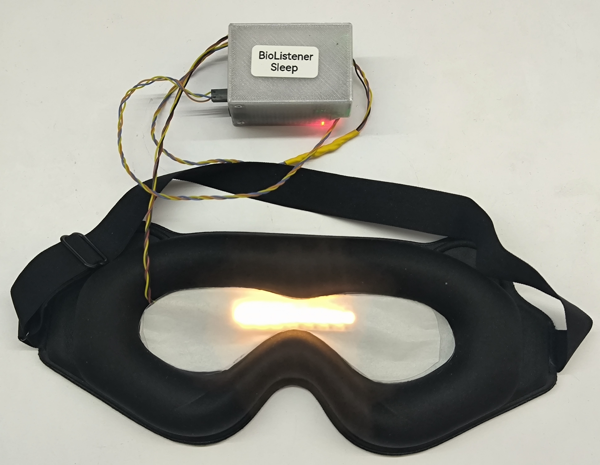

# BioListener Sleep Mask Firmware

Firmware for the **BioListener Sleep Mask** — an ESP32 / ESP32-S3 strobe mask driven over WiFi (UDP) by a host controller.

Built with **PlatformIO** and the **Arduino framework**.

<p align="center">
  
</p>

## Features

- **Strobe engine**: frequency, fill (duty) cycle, RGBW color, brightness, per-LED bitmask; driven by a 100 µs hardware timer, rendered on core 1.
- **UDP control**: JSON commands on port `20000`, 2 s ping so the controller can discover the board.
- **WiFi setup portal**: WiFiManager captive portal; controller IP/port stored in LittleFS.
- **Power**: button wake / deep sleep and battery voltage reporting.

## Supported Boards

| Env | Board |
|-----|-------|
| `esp32dev` | ESP32 D1 MINI (ESP-WROOM-32) |
| `esp32-s3-devkitc-1` | ESP32-S3 (4 MB flash, 2 MB PSRAM) |

## Getting Started for Users

### Flashing via USB
- Download the latest firmware from the GitHub Actions page and use the `merged-flash.bin` file.
- Flash it with the [online web tool from Espressif](https://espressif.github.io/esptool-js/).

## Getting Started for Developers
- Install the **PlatformIO** extension in **Visual Studio Code**.
- Use `platformio.ini` to select the board env and set pins via build flags:
  - **LED_PIN**: strobe NeoPixel data pin
  - **STATUS_LED_PIN**: status NeoPixel pin
  - **BUTTON_PIN**: power button pin (`-1` to disable)
  - **BATTERY_PIN**: battery ADC pin
- Build and upload with the **PlatformIO** extension.

## Usage

On first run the board creates a WiFi access point named `Mask_******`. Connect to it and open `192.168.4.1` in your browser to set the WiFi credentials and the controller (master) IP and port.

After every start the configuration portal is available again on that access point for 2 minutes, or until the first UDP command arrives.

Status LED: **red** — booting, **blue** — config portal / not connected, **green** — WiFi connected, **yellow** — power button held / going to sleep.

## Control Protocol

UDP JSON on port `20000`.

Set parameters (`command: 0`):
```json
{"command": 0, "enabled": true, "frequency": 10.0, "fill": 0.1, "brightness": 0.5, "color": [255, 255, 255, 0], "mask": 255}
```

Read parameters (`command: 1`) — the board replies with `type: "params"`, including `battery`.

## Host Controller

`mask_strobe_controller/` is a Flask app that plays an audio track and streams the matching strobe parameters to the mask.

```bash
pip install flask pandas pyyaml python-vlc
python mask_strobe_controller/app.py
```

Session audio and strobe CSVs live in `mask_strobe_controller/data/` and are not part of this repository. `mock_mask.py` emulates a board for testing; `brightness_calibration.py` is an interactive brightness sweep.
